<p align="center">
  
</p>

<h1 align="center">推量牛（bullflow）</h1>

<p align="center">
  <b>AI 巨量内容 × 全域曝光，自主获客与变现</b><br>
  开源的<b>企业级 RAG 解决方案</b> · 从企业知识库到全域内容分发
</p>

<p align="center">
  <b>简体中文</b> | <a href="README.en.md">English</a>
</p>

<p align="center">
  
  
  
  
  
  
  
</p>

> 🏢 **完整的企业商用级开源项目**：用户端、运营后台、分发网关三套系统齐全，多租户、权限、计费、支付、审计等商用能力均已实现，MIT 协议可免费商用。

推量牛是一套**企业级 RAG 解决方案**：先把企业的公司 / 品牌 / 产品 / 客户 / 案例、文档、图片、音视频沉淀为**专属知识库**，再由 AI Agent 基于这些资产**创作文章、图文、图片、视频**，最后**一键分发到国内外 17 个主流社媒平台**，并把发布结果与账号数据回流分析——从「素材」到「曝光」一条链路走完。

**整条 RAG 链路不依赖任何付费模型**：文档 OCR、语义分句、向量化、重排、以文搜图、语音转录全部使用开源模型**本地免费部署**，知识库建得再大也没有一分钱调用费，企业资料也不出内网。

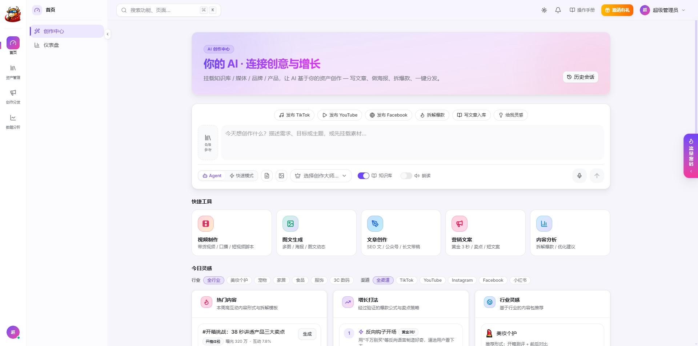

**目录**：[为什么是推量牛](#为什么是推量牛) · [企业商用级](#企业商用级开箱即可运营) · [适用场景](#适用场景) · [功能一览](#功能一览) · [端到端示例](#端到端示例一份产品文档--全网铺开) · [技术架构](#技术架构) · [快速开始](#快速开始) · [接入推量发网关](#接入推量发网关) · [构建后端镜像](#构建后端镜像) · [Docker 部署](#docker-部署) · [项目结构](#项目结构) · [开发指南](#开发指南) · [常见问题](#常见问题) · [路线图](#路线图与已知限制) · [关于中巨量](#关于中巨量)

## 为什么是推量牛

通用 AI 写作工具不了解你的企业，写出来的东西「像 AI、不像你」；传统矩阵分发工具只负责发，不负责写；两者之间还隔着大量复制、粘贴、改格式、逐个平台登录的体力活。推量牛把这三段连成一条闭环：

| | 通用 AI 写作 | 矩阵分发工具 | **推量牛** |
|---|---|---|---|
| 了解你的企业 | ✗ 每次都要重新交代背景 | ✗ | ✅ 企业档案 + 知识库自动注入，回答带**引用来源** |
| 知识库与检索成本 | 向量化 / 检索按调用次数付费 | — | ✅ **全部开源模型本地运行，零调用费**，数据不出内网 |
| 内容形态 | 纯文本为主 | 不负责生产 | ✅ 文章 / **图文混编（自动配图）** / 多图动态 / 图片 / 视频 / 语音朗读 |
| 多平台发布 | ✗ | ✅ | ✅ 国内 11 + 海外 6 平台，**一个网关**统一接入 |
| 账号安全 | — | 视产品而定 | ✅ 按区域固定代理 IP、同 IP 同平台账号数上限、自动巡检迁移 |
| 数据回流 | ✗ | 部分 | ✅ 发布结果 Webhook 回写 + 每日账号指标采集 |
| 部署与数据 | SaaS，数据在别人手里 | SaaS | ✅ **私有化部署**，向量库 / 全文检索 / 对象存储 / OCR / 语音全部可自建，模型可离线打包 |
| 商业化 | — | — | ✅ 积分计费、订阅、支付、发票、邀请返佣、销售归因、埋点漏斗**开箱即用** |

**核心优势一句话：先懂你的企业，再替你创作，最后帮你铺满全网。**

- 🧠 **不是对话套壳，而是企业知识驱动。** 每次对话 / 生成都会按需注入 5 类企业档案（公司、品牌、产品、客户、案例），文章生成还会检索知识库；回复下方列出命中片段与相关度分数，可一键预览原文——内容可追溯、可核对。
- 💸 **RAG 不依赖付费模型，本地免费部署。** 知识库的每一个环节——OCR（PaddleOCR）、语义分句（wtpsplit）、文本向量（BGE-M3）、重排（BGE-Reranker）、以文搜图（OpenCLIP）、语音转录（WhisperX）——都是开源模型，跑在你自己的服务器上：入库多少文档、检索多少次都**不产生任何调用费用**，GPU 不是必需品，有 GPU 时自动加速；企业资料全程不出内网。只有最终「写文章、出图、出视频」这一步才调用大模型，而且走 OpenAI 兼容接口，供应商随你选。
- 🔍 **工业级 RAG，而不是「把 PDF 丢给模型」。** OCR → Pandoc → 原生解析的四级降级链，PDF / Word / Excel / PPT / Markdown / HTML / EPUB 等 12 种格式可直接解析入库；语义分句 + 动态规划分块、表格 / 代码块整块保护；Milvus 向量 + Elasticsearch（IK 分词）**混合检索**，RRF 融合、可选重排、相邻块扩展、自适应检索判断，还自带 **Ragas 评测与权重自动调优**。
- 🖼️ **按平台形态生成内容。** 公众号 / 头条 / 百家号这类文章平台 → **图文混编文章**（正文内自动生成并嵌入配图）；小红书 / 微博这类图文平台 → **多图动态**（1–9 张并发出图 + 配套种草文案）；Agent 会根据你要发的平台自动选择形态。
- 🌏 **国内 + 海外，一个网关。** 抖音、快手、小红书、视频号、公众号、B 站、知乎、微博、头条、百家号、多多视频，以及 LinkedIn、Facebook、Instagram、Reddit、YouTube、X——一份内容勾选多个平台一次发出，各平台字数 / 图片规则自动校验。
- 🛡️ **矩阵账号的安全与成本都替你想好了。** 扫码授权、账号云端托管；代理 IP 按区域粘性分配、同 IP 同平台最多 15 个账号、每 20 分钟健康巡检并自动迁移；14 天未使用的账号自动回收停止计费，重新扫码即恢复。
- ⏰ **定时自动生成 + 自动分发。** 按星期与时刻设定规则，到点自动产出内容并直接发到指定账号，完成或失败都有站内通知——真正的「无人值守」内容矩阵。
- 💰 **商业化能力完整。** 这不是一个 Demo：按 Token / 张数 / 秒数精确计费、后付费防透支、订阅与加量包、通联支付 + 对公转账、发票、邀请返佣、销售归因、9 步转化漏斗、通知通道（邮件 / 飞书 / 企业微信）全部已实现，拿来即可运营。
- 🏠 **私有化部署、数据自持。** 所有组件均可自建，HuggingFace 模型与 FFmpeg 构建时打进镜像，运行时零下载；大模型走 OpenAI 兼容接口，可随时替换供应商。

### 企业商用级：开箱即可运营

很多开源 AI 项目只给一个对话界面或一段 Pipeline 脚本，要上线还得自己补账号、权限、计费、支付、后台……推量牛把**一家 SaaS 公司对外运营所需的整套系统**都做完了：

| 维度 | 已实现的能力 |
|---|---|
| **三套完整系统** | 用户端（创作、资产、分发、数据）· 运营管理后台（6 个分组 / 23 个菜单）· 推量发分发网关（可独立部署，自带管理界面） |
| **账号与权限** | 邮箱 / 手机号注册登录、短信验证码登录、找回密码；超级管理员 / 管理员 / 用户 / 销售 / 财务多角色；后台角色权限管理 |
| **多租户** | 所有业务数据按租户隔离，MySQL、Milvus 向量库、Elasticsearch 三处检索强制按用户过滤 |
| **计费与收款** | 积分计费（按 Token / 张数 / 秒数 / 发布账号数精确扣减）、后付费防透支、订阅套餐（月 / 季 / 年，支持补差价升级）、加量包、通联支付（支付宝 / 微信）+ 对公转账、订单超时自动取消、发票申请与邮件通知 |
| **增长与运营** | 邀请返佣、销售引流归因、站内消息推送、邮件 / 飞书 / 企业微信通知通道、用户反馈、Skill 池与流量密码内容运营、平台参数在线配置 |
| **数据分析** | 用户端数据仪表板；后台财务报表、9 步转化漏斗、创作分析、支付分析、事件明细埋点 |
| **安全与合规** | JWT 双 Token + Redis 黑名单、全局与登录接口分级限流、滑块验证码、审计日志与后台操作日志、Webhook HMAC 签名防重放、用户协议与隐私政策页面 |
| **工程交付** | Alembic 数据库迁移、Docker Compose 部署、模型离线打包进镜像、pytest 单元测试、前后端开发规范文档、6 语言 i18n 框架、浅色 / 深色双主题 |
| **授权** | MIT 协议，**允许免费商用、修改与二次分发**，可直接作为自有品牌产品上线 |

## 适用场景

| 场景 | 推量牛怎么帮你 |
|---|---|
| **品牌社媒矩阵运营** | 一次创作，同时发往抖音、小红书、视频号、公众号、知乎……定时任务让矩阵每天自动更新，数据仪表板统一看各平台成败。 |
| **跨境电商 / 出海营销** | 同一套产品资料，分别生成适合 LinkedIn、Facebook、Instagram、Reddit、X、YouTube 的内容；产品卖点图、热点图按参考图风格批量出图。 |
| **ToB 企业内容营销** | 白皮书、案例、产品文档上传即入库，AI 基于真实资料写行业文章与公众号长文，引用可溯源，避免「一本正经地胡说」。 |
| **MCN / 代运营机构** | 多租户隔离，每个客户的知识库、账号、内容互不可见；积分计费与订阅体系可直接对外售卖服务。 |
| **门店 / 本地生活** | 产品图 + 一句需求 → 小红书多图笔记 + 种草文案；短视频脚本、口播稿、营销文案一键生成。 |
| **企业知识问答** | 文档、PPT、Excel、音频会议录音统一入库，用自然语言提问，答案附带原文出处。 |

## 功能一览

### 一、AI 创作中心（Agent）

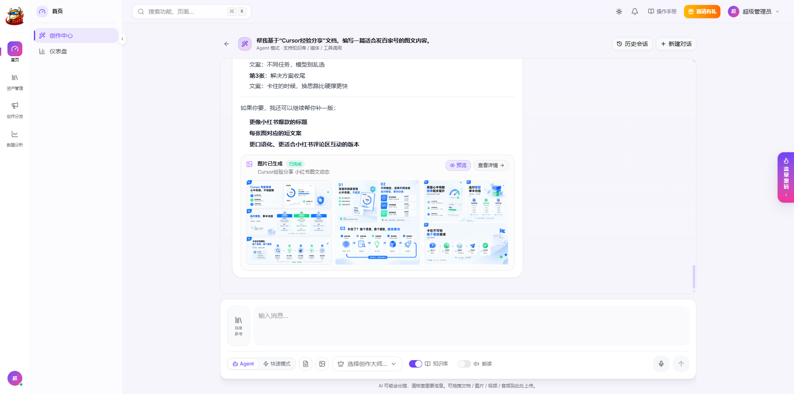

基于 **LangGraph ReAct** 的创作 Agent，逐 token 真流式输出（SSE），一次对话里可以连续完成「检索 → 写作 → 出图 → 导出」：

| Agent 工具 | 能力 |
|---|---|
| `knowledge_search` | 检索企业知识库（可多次调用），命中片段作为引用来源展示 |
| `generate_article_content` | 生成文章，`mixed=true` 时为**图文混编**（正文自动插入 AI 配图） |
| `generate_image_content` | 生成 1–9 张图片；挂载参考图时自动走图生图；`as_dynamic` 打包成图文动态 |
| `generate_video_content` | 生成 1–15 秒短视频 |
| `export_article_content` | 导出 PDF / Word |
| `create_customer` | 对话中直接新建客户档案 |

- **两种模式**：Agent 模式（多轮对话 + 工具调用）/ 快速模式（填一句需求直接出文章、图片或视频）。
- **挂载参考素材**：最多 8 个——文档全文、图片（多模态理解）、品牌 / 产品资料。
- **创作大师（Skill）**：内置 **56 个**创作技能（去 AI 味、小红书爆款笔记、SEO 写作、短视频脚本、营销文案……），文章类注入系统提示词，图片 / 视频类先由 LLM 把简单需求改写成专业提示词。
- **灵感库与快捷入口**：爆款拆解、增长打法、行业灵感、一键「发布 TikTok / YouTube / Facebook」等快捷指令。
- **语音**：语音输入转文字；助手回复可用 IndexTTS 朗读。
- **拖拽上传**：把文件拖进对话框，自动分类进文档 / 图片 / 视频 / 音频库。

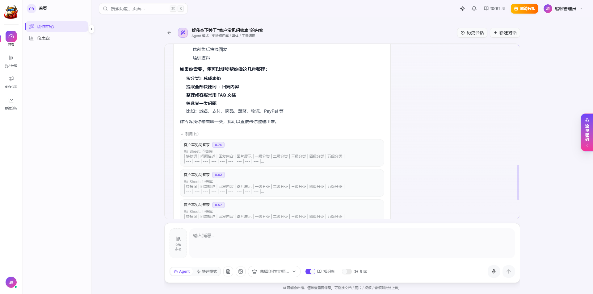

> 回答下方的「引用（N）」列出每个命中的知识库片段、所属文档与相关度分数，点开即可预览原文。

### 二、企业知识库与 RAG

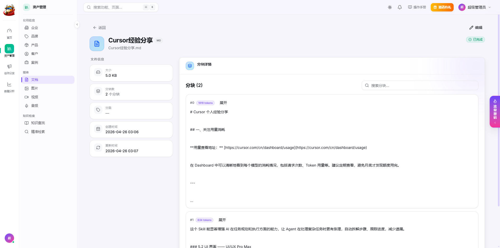

**结构化档案**：公司、品牌、产品、客户、案例 5 类档案统一维护，生成时按 `auto`（自动注入，带条数上限）/ `custom`（只用勾选条目 + 最多 2 篇文档全文）/ `none` 三种模式参与创作。

**文档解析降级链**（每一级失败都会记录日志后自动降级）：

```
① PaddleOCR PP-StructureV3   PDF（≤100 页）/ 图片，版面 + 表格结构化识别
② Pandoc → GFM Markdown       doc / docx / html / epub / rtf / odt …
③ 原生解析器                  PyMuPDF / python-docx / openpyxl / python-pptx（PPTX 内嵌图片并发 OCR）
④ 二进制兜底                  识别文件头，无法提取文本则「仅存储」不入库
```

- **支持的文档格式**：pdf / docx / xlsx / pptx / txt / csv / md / html / htm / epub / rtf / odt 共 12 种可解析入库；旧版二进制格式 doc / xls / ppt 可上传存储，但无法提取文本，建议另存为 docx / xlsx / pptx 后上传。
- **语义分块**：wtpsplit SaT 句子边界检测 + 标题感知 + 动态规划最优合并（借鉴 RAGLite），表格与代码块整块保护；普通块 ≤ 2048 字符、表格块 ≤ 4096 字符。
- **三库同步入库**：MySQL（分块原文）+ Milvus（BGE-M3 1024 维向量）+ Elasticsearch（IK 分词全文索引）。
- **媒体资产**：图片走 OpenCLIP ViT-L-14 向量化，支持**以文搜图**；视频自动提取元数据并截取封面；音频经 WhisperX 转录（中文走专用模型并自动繁转简）后作为文档走完整 RAG 流程。
- **统一查找**：一次搜索同时覆盖文档、图片、音频、视频。

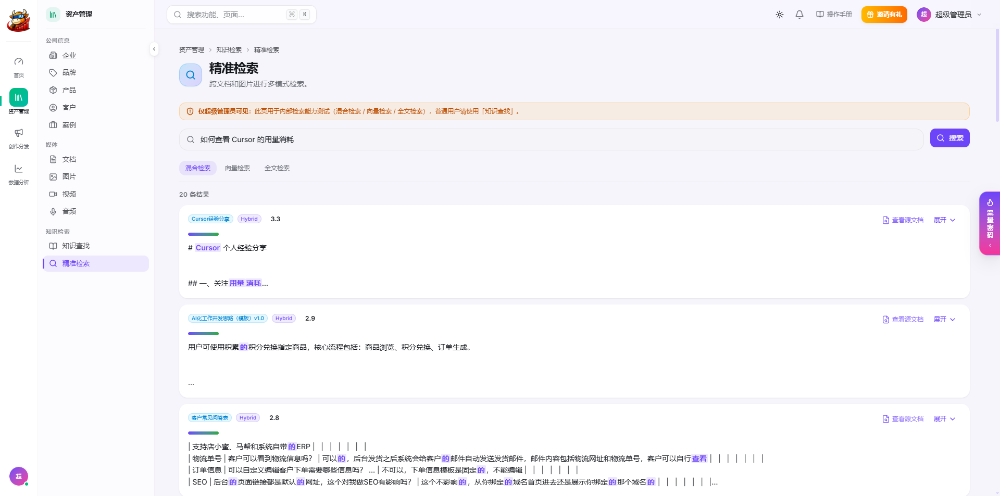

**混合检索**（`services/knowledge_service.py`）：

| 环节 | 做法 |
|---|---|
| 召回 | Milvus 向量召回 ∥ ES 全文召回（IK 分词，预留同义词过滤器，可在 `core/elasticsearch.py` 中配置），并行各取 top_k×3 |
| 融合 | 默认 **RRF**（k=60），可切换为归一化加权（默认 0.6 / 0.4） |
| 过滤 | 向量分低于阈值（默认 0.40）直接丢弃 |
| 重排 | 可选 BGE-Reranker-v2-m3 精排（最多 20 个候选，带分数阈值） |
| 扩展 | 命中块自动拼接前后相邻块，给 LLM 更完整的上下文 |
| 自适应 | 先由 LLM 判断问题是否需要检索，需要时再改写检索词 |
| 优化 | 可选 Query Adapter（正交 Procrustes 变换），可从评测数据训练 |
| 评测 | Ragas 四项指标 + 网格搜索自动调优混合权重 |

**知识库全链路使用本地开源模型，零调用费**：

| 环节 | 开源模型 / 组件 | 运行方式 |
|---|---|---|
| 文档 OCR | PaddleOCR PP-StructureV3 | 自建服务（推荐 GPU，可关闭） |
| 语义分句 | wtpsplit SaT `sat-3l-sm` | 后端进程内，CPU |
| 文本向量 | BGE-M3（1024 维，中英多语种） | 后端进程内，CPU / GPU 自动选择 |
| 检索重排 | BGE-Reranker-v2-m3（可选） | 后端进程内 |
| 以文搜图 | OpenCLIP ViT-L-14 | 后端进程内 |
| 语音转录 | WhisperX（faster-whisper large-v3-turbo，中文用 Belle 专用模型） | 自建服务 |
| 语音朗读 | IndexTTS | 自建服务 |
| 向量库 / 全文检索 | Milvus、Elasticsearch + IK | 自建 |

> 模型在构建镜像时即可打包进去，运行时不联网、不下载。只有内容生成（写作、生图、生视频）会调用大模型 API：所有供应商都通过 OpenAI 兼容客户端接入，`*_BASE_URL` 均可配置，也可以尝试指向自建的 OpenAI 兼容推理服务（如 vLLM、Ollama）。

### 三、内容生成

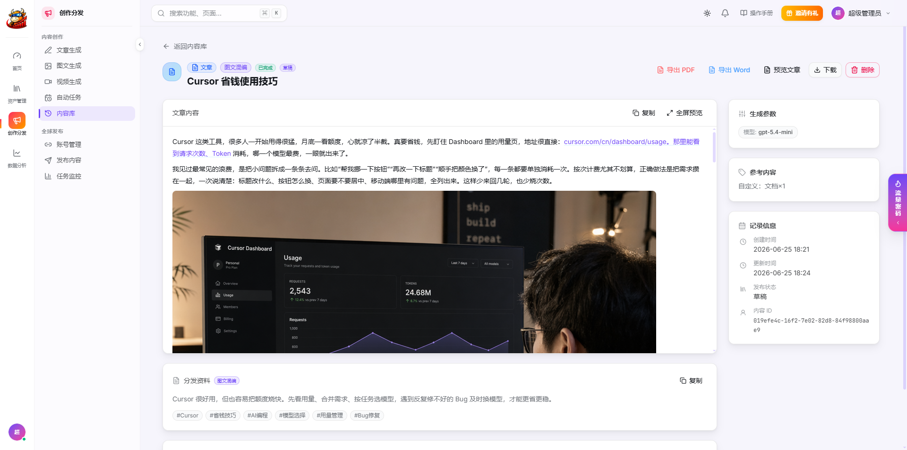

| 类型 | 能力 |
|---|---|
| **文章** | 8 个内置模板；可选模型；**图文混编**：LLM 在正文中输出 `[[IMG:描述]]` 占位符 → 并发生成配图 → 按位置替换（模型没标注时也会自动补图并均匀插入）；导出 PDF（Pandoc + WeasyPrint）/ Word |
| **图片** | 8 个内置模板；一次 1–9 张并发生成，部分失败不影响其他张；最多 8 张参考图（图生图）；「生成发布动态」同步产出种草文案 |
| **视频** | 6 个内置模板；首帧 + 尾帧控制；720p / 1080p；5 / 10 / 15 秒；可选带音频 |
| **元数据** | 每条内容自动生成标题、描述、标签，直接可用于发布 |
| **自动任务** | 按星期 + 时刻定时生成，可「立即执行」；生成完成后可**自动分发**到指定平台账号 |

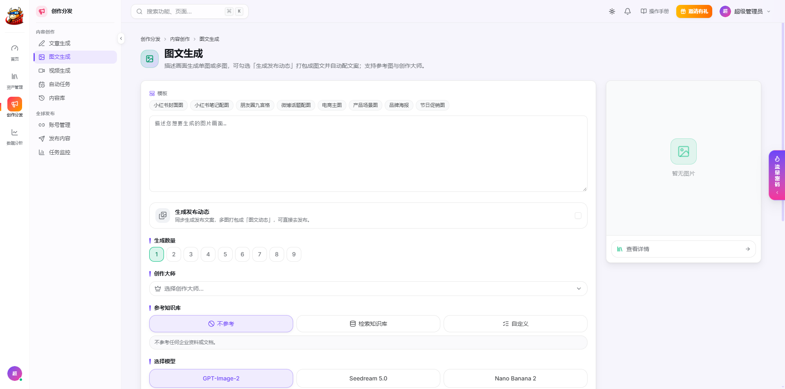

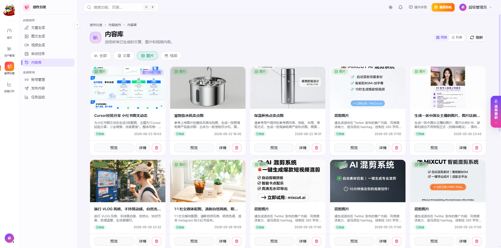

**支持的模型供应商**（均可在管理后台配置单价、启用 / 停用）：

| 类型 | 模型 |
|---|---|
| 文本 | Azure OpenAI（GPT-5.4 / Mini / Nano）、火山方舟（豆包 Seed 2.0 Pro / Lite / Mini）、阿里云百炼（通义千问） |
| 图片 | GPT-Image-2（Azure）、豆包 Seedream 5.0、腾讯智能创作 GEM（Nano Banana 2） |
| 视频 | 豆包 Seedance 2.0、可灵 Kling 3.0（腾讯 VOD） |
| 语音 | IndexTTS（自建）朗读；WhisperX（OpenAI 兼容接口）转录 |

> 所有生成任务都是异步的：提交后立即返回，后台任务完成生成并入库，关闭页面也不影响结果。

### 四、全平台分发（推量发网关）

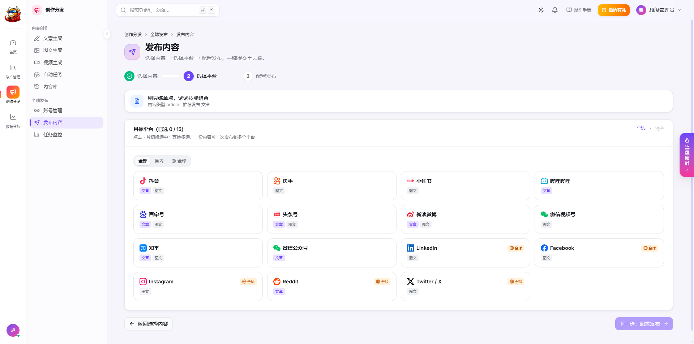

分发能力由独立的 **推量发网关**（`tlf_backend/`）提供，主站通过 SDK + Webhook 与之对接，也可以单独部署给其他产品使用（接口文档见 [`tlf_backend/docs/`](tlf_backend/docs/)）。

> 网关本身开源，但真正登录、发布到各平台依赖两个第三方服务：国内平台走 [灵径](https://app.lapi.cc)（按账号计费），海外平台走 [Composio](https://composio.dev)。使用分发功能需要自行开通这两个服务的账号，配置方法见[接入推量发网关](#接入推量发网关)。不配置时，知识库、AI 创作、内容生成等功能不受影响。

**已开放平台（17 个）**

| 国内（11） | 海外（6，经 Composio OAuth） |
|---|---|
| 抖音、快手、小红书、哔哩哔哩、百家号、头条号、新浪微博、微信视频号、知乎、微信公众号、多多视频 | LinkedIn、Facebook、Instagram、Reddit、YouTube、X（Twitter） |

> 上游已支持另外 8 个国内平台（雪球号、快传号、AcFun、易车号、美拍、爱奇艺、搜狐视频、腾讯微视），网关字段规格表覆盖 38 个国内平台，可按需开放。

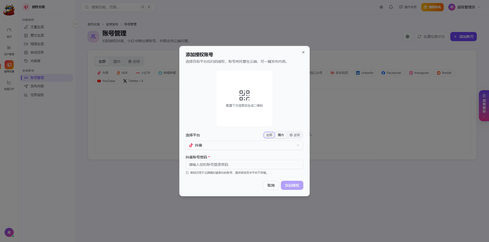

| 能力 | 说明 |
|---|---|
| **三步发布** | 选内容 → 选平台（按内容形态自动标出支持「文章 / 图文」的平台）→ 配置发布（定时、原创声明、AI 声明、字数规则校验） |
| **扫码授权** | 选择平台和代理区域后扫码；部分平台需要的登录密码仅透传给上游，不落库 |
| **防关联** | 代理 IP 按区域粘性分配，同一 IP 同一平台最多 15 个账号，超出自动换同区域 IP |
| **代理巡检** | 每 20 分钟检测连通性与出口延迟，连续失败自动禁用并迁移账号 |
| **成本控制** | 14 天未使用的账号自动在上游注销会话停止计费，重新扫码即恢复，账号 ID 不变 |
| **结果回流** | 授权、发布结果、发布进度、审核状态、账号数据、账号状态 6 类 Webhook；HMAC-SHA256 签名 + 时间戳防重放 + nonce，失败按 1 / 3 / 10 秒退避重试 |
| **数据采集** | 每日定时采集粉丝、作品、点赞、播放 4 项账号指标 |
| **风控处理** | 平台风控短信验证、批量检查账号登录状态 |

### 五、数据分析

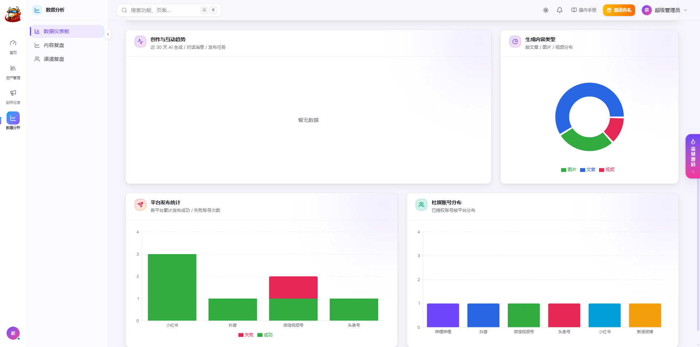

- 上传文件、AI 生成、发布任务、社媒账号四大指标卡。
- 近 7 / 30 / 90 天的上传趋势、创作与互动趋势。
- 生成内容类型分布、各平台发布成功 / 失败统计、社媒账号平台分布。

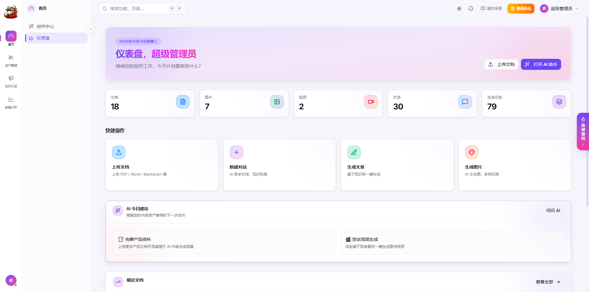

### 六、商业化与运营后台

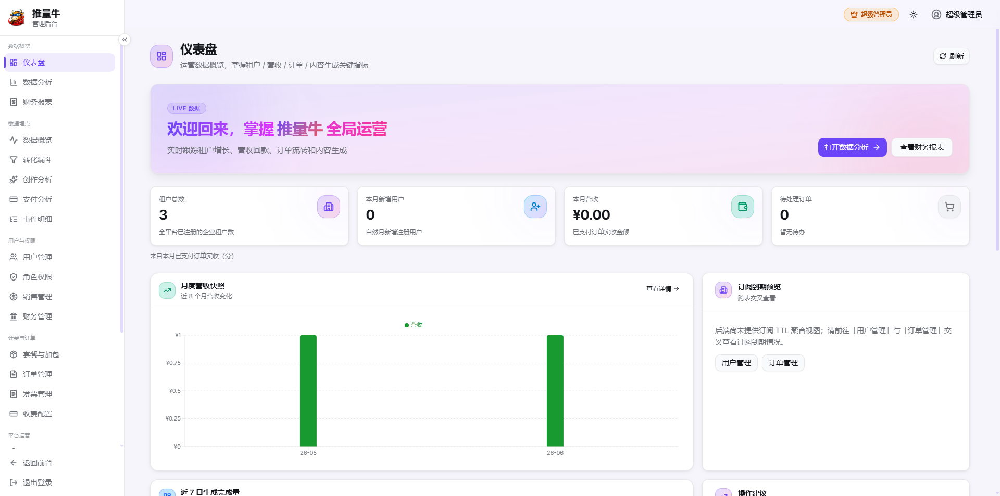

管理后台（`admin_frontend/`）共 **6 个分组、23 个菜单**：

| 分组 | 菜单 |
|---|---|
| 数据概览 | 仪表盘、数据分析、财务报表 |
| 数据埋点 | 数据概览、转化漏斗（页面访问 → 注册 → 创作 → 生成 → 导出 → 访问套餐 → 支付，9 步）、创作分析、支付分析、事件明细 |
| 用户与权限 | 用户管理、角色权限、销售管理（引流归因）、财务管理 |
| 计费与订单 | 套餐与加包、订单管理、发票管理、收费配置 |
| 平台运营 | 平台设置、消息推送、通知通道（邮件 SMTP / 飞书 / 企业微信）、用户反馈、Skill 池 |
| 资源运维 | 流量密码、操作日志 |

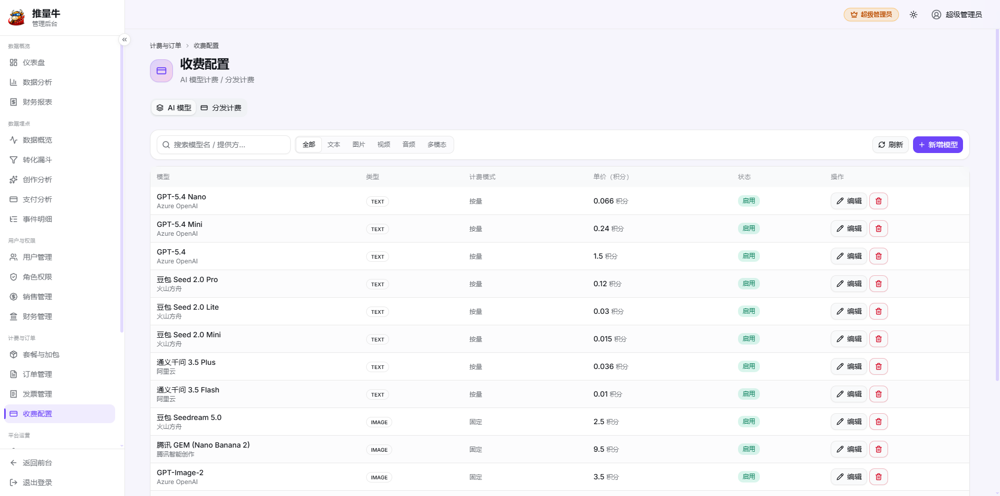

**计费模型**

- 文本按每 1K tokens 计费；图片按「单价 × 尺寸倍率」**按实际成功张数逐张扣**；视频按「单价 × 分辨率倍率 × 实际秒数」；分发按发布账号数计费。
- **后付费防透支**：生成前按预估校验余额，生成后按实际用量扣减，余额不足扣到 0，杜绝「少量余额无限使用」。
- 订阅套餐（月付 / 季付 / 年付，支持补差价升级）+ 加量包；通联支付（支付宝 / 微信，RSA 验签）+ 对公转账审核；订单 30 分钟未付自动取消。
- 积分流水全量可查；用户在线申请发票，开票后邮件通知。
- **邀请有礼**：好友注册、好友首次充值各奖励一次。
- **流量密码**：运营在后台维护增长工具与流量秘籍卡片，在用户端以悬浮窗展示。

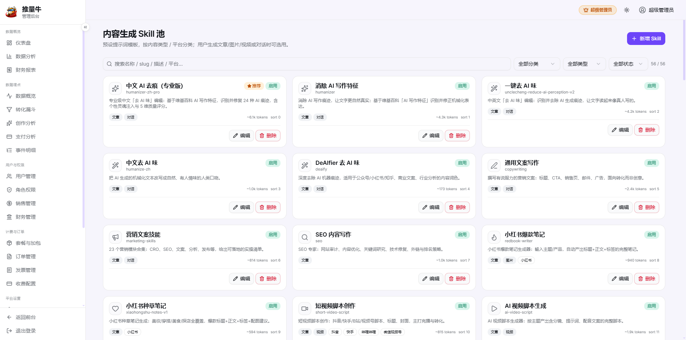

### 七、体验细节

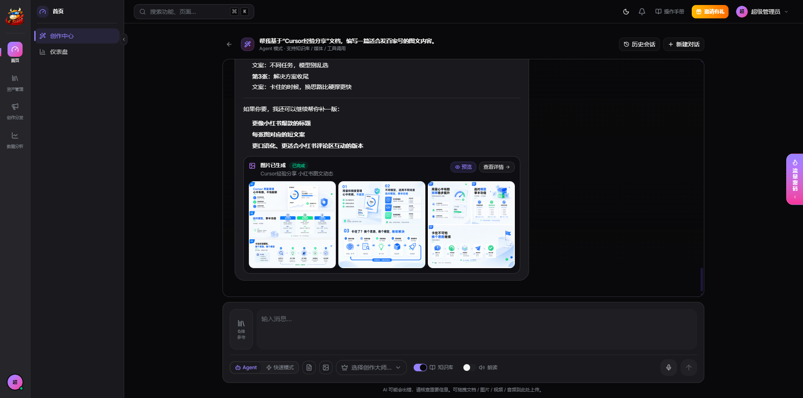

- 浅色 / 深色双主题，shadcn/ui（new-york）+ Radix UI + OKLCH 色彩体系，用户端与管理后台共用一套设计系统。
- ⌘K 全局搜索，快速跳转到任意功能页面。
- 自研滑块验证码（同 IP / 账号连续失败 3 次后才出现），短信验证码按手机号与 IP 多维度限流。
- 发版后旧代码分片加载失败会自动刷新一次，用户无感升级。

## 端到端示例：一份产品文档 → 全网铺开

1. **资产管理 → 文档**，上传《产品白皮书.pdf》；系统自动 OCR、语义分块、写入向量库与全文索引。在**产品 / 品牌**中补充卖点与调性。
2. 打开 **AI 创作中心**，输入：「基于《产品白皮书》写一篇适合公众号的图文文章，再做一组小红书 4 图笔记」。
3. Agent 先调用 `knowledge_search` 检索白皮书，再分别调用 `generate_article_content(mixed=true)` 和 `generate_image_content(count=4, as_dynamic=true)`；回复里出现两张生成卡片，以及引用来源。
4. 在**内容库**打开文章，检查正文与配图，需要时导出 Word 交给法务审核。
5. **发布内容** → 选中这篇文章 → 勾选微信公众号、头条号、百家号、知乎、LinkedIn → 设置定时 → 提交；小红书笔记同理。
6. 在**任务监控**查看各平台发布进度，Webhook 自动回写结果；第二天在**数据仪表板**查看各平台成败与账号数据。
7. 想每周自动更新？在**自动任务**里建一条「每周一、四 9:00 生成并自动分发」的规则即可。

## 技术架构

```
                                    ┌──────────────────────────────────────────┐
浏览器 ── frontend (React 19) ──┐    │ backend (FastAPI · SQLAlchemy 2 async)   │
       admin_frontend ──────────┼──▶ │  Agent (LangGraph) · RAG · 生成 · 计费   │
                                │    └───┬───────┬───────┬───────┬───────┬──────┘
                                │        │       │       │       │       │
                                │     MySQL  Milvus  Elastic  Redis   MinIO
                                │             (向量) (IK 全文)(缓存/限流)(对象存储)
                                │        │
                                │        ├── PaddleOCR（PP-StructureV3，可选 GPU）
                                │        ├── WhisperX / IndexTTS（语音，可选）
                                │        └── LLM / 生图 / 生视频（OpenAI 兼容）
                                │
                                │    ┌──────────────────────────────────────────┐
       tlf_frontend ────────────┴──▶ │ tlf_backend 推量发网关（SDK + Webhook）  │──▶ 灵径（国内平台）
                                     │  账号绑定 · 代理调度 · 发布 · 数据采集   │──▶ Composio（海外平台）
                                     └──────────────────────────────────────────┘
```

**请求链路**：`限流（60 次/分钟/IP）→ 审计日志 → CORS → JWT 解析 + Redis 黑名单 + 用户状态 → 路由 → service → 存储`。

| 层 | 技术选型 |
|---|---|
| 后端 | Python 3.12 · FastAPI · SQLAlchemy 2.0 async · Alembic · Pydantic v2 · LangGraph / LangChain · APScheduler |
| 检索与模型 | Milvus 2.5 · Elasticsearch 8（IK）· BGE-M3 · BGE-Reranker-v2-m3 · wtpsplit SaT · OpenCLIP ViT-L-14 · Ragas |
| 文档处理 | PaddleOCR PP-StructureV3 · Pandoc · PyMuPDF · python-docx / openpyxl / python-pptx · WeasyPrint · FFmpeg |
| 前端 | React 19 · Vite 8 · TypeScript · Tailwind CSS 4 · shadcn/ui + Radix UI · Zustand · React Router 7 · i18next · Recharts · Framer Motion |
| 部署 | Docker Compose · Nginx |

**工程约定**（详见 [`CLAUDE.md`](CLAUDE.md) 与各端 `AGENTS.md`）：

- **多租户隔离**：所有业务表带 `user_id`，MySQL 查询、Milvus 检索、ES 检索均强制按用户过滤。
- **时间统一 UTC**：写库用 `utcnow()`，数据库会话时区 `+00:00`，返回前端统一带时区。
- **异步管线**：上传 / 生成立即返回，后台任务用独立数据库会话处理，失败时可靠地标记状态，ML 推理走 `asyncio.to_thread` 不阻塞事件循环。
- **第三方调用可观测**：所有外部 HTTP 调用记录 URL、参数、状态码与截断后的响应。
- **模型加载**：默认懒加载；`MODEL_PRELOAD_ENABLED=true` 时启动并发预加载。

## 快速开始

### 环境要求

| 项目 | 要求 |
|---|---|
| 运行时 | Python 3.12、Node.js 20+ |
| 系统工具 | Pandoc（文档转 Markdown）、FFmpeg + FFprobe（视频处理）；导出 PDF 需要 WeasyPrint 依赖的 Pango / Cairo 系统库，以及中文字体（如 `fonts-noto-cjk`） |
| 内存 | 建议 ≥ 16 GB（BGE-M3、CLIP、wtpsplit 常驻内存；开启重排还需额外加载 BGE-Reranker） |
| GPU | 可选。向量模型自动检测 CUDA，无 GPU 时回退 CPU；PaddleOCR 服务建议使用 NVIDIA GPU |
| 磁盘 | 模型文件合计数 GB，另需为 MySQL / Milvus / ES / MinIO 预留数据空间 |

> 以 Debian / Ubuntu 为例，系统依赖可参考 `backend/Dockerfile`：`apt install pandoc libpango-1.0-0 libpangoft2-1.0-0 libcairo2 libgdk-pixbuf-2.0-0 shared-mime-info fonts-noto-cjk`。

### 依赖服务

| 服务 | 用途 | 获取方式 |
|---|---|---|
| MySQL 8 | 业务数据（主库 `matrix365` + 推量发独立库 `matrix365_tlf`，需事先建库，utf8mb4） | 自行部署 |
| Redis | 缓存 / JWT 黑名单 / 限流 | 自行部署 |
| Elasticsearch 8 + [IK 分词插件](https://github.com/infinilabs/analysis-ik) | 全文检索（索引在后端启动时自动创建） | 自行部署 |
| Milvus 2.5 + MinIO | 向量库 / 对象存储 | `docker compose -f docker-compose.milvus.yml up -d` |
| PaddleOCR（可选） | PDF / 图片 OCR | 见 `paddleocr/`；不部署时设 `OCR_ENABLED=false`，自动降级到 Pandoc / 原生解析 |
| WhisperX（可选） | 音频转录 | 任意 OpenAI 兼容的转录接口 |
| IndexTTS（可选） | 语音朗读 | 自建 IndexTTS 服务 |
| LLM / 生图 / 生视频 | Azure OpenAI、火山方舟、阿里云百炼、腾讯云等 | 在 `.env` 中填写各自的 Key，至少配置一个文本模型 |

> `docker-compose.milvus.yml` 中 MinIO API 映射到宿主机 **9100** 端口（容器内 9000，控制台 9101），账号密码为 `MINIO_ROOT_USER` / `MINIO_ROOT_PASSWORD`；`backend/.env` 的 `MINIO_ENDPOINT` / `MINIO_PUBLIC_URL`（`.env.example` 默认 `localhost:9100`）与 `MINIO_ACCESS_KEY` / `MINIO_SECRET_KEY` 需与之一致。

**准备数据库与 ES 插件**：

```sql
-- MySQL：主库与推量发网关库（库名与 .env 中的 MYSQL_DATABASE 一致）
CREATE DATABASE matrix365     DEFAULT CHARACTER SET utf8mb4 COLLATE utf8mb4_unicode_ci;
CREATE DATABASE matrix365_tlf DEFAULT CHARACTER SET utf8mb4 COLLATE utf8mb4_unicode_ci;
```

```bash
# Elasticsearch：安装与 ES 版本号完全一致的 IK 插件后重启 ES
bin/elasticsearch-plugin install https://get.infini.cloud/elasticsearch/analysis-ik/<你的 ES 版本号>
```

### 本地开发

以下命令均从**仓库根目录**开始，每个服务在单独的终端中运行。

**1. 克隆仓库并复制配置文件**，按需填写数据库连接与各云服务 Key：

```bash
git clone https://github.com/jaikydota/BullFlow.git
cd BullFlow
cp backend/.env.example backend/.env
cp frontend/.env.example frontend/.env
cp admin_frontend/.env.example admin_frontend/.env
cp tlf_backend/.env.example tlf_backend/.env      # 使用分发功能时需要
```

**2. 后端**（:8020）：

```bash
cd backend
python -m venv venv && source venv/bin/activate
pip install -r requirements.txt
alembic upgrade head
python -m scripts.seed_skills                     # 导入 56 个内置创作技能（只需执行一次，可重复执行）
uvicorn app.main:app --host 0.0.0.0 --port 8020 --reload --reload-dir app
```

**3. 用户端**（:5288，`/api` 代理到 :8020）：

```bash
cd frontend && npm install && npm run dev
```

**4. 管理后台**（:5290）：

```bash
cd admin_frontend && npm install && npm run dev
```

**5. 推量发网关**（可选，后端 :8041 / 管理界面 :5391）：

```bash
cd tlf_backend
python -m venv venv && source venv/bin/activate
pip install -r requirements.txt
alembic upgrade head
uvicorn tlf_app.main:app --host 0.0.0.0 --port 8041 --reload
```

```bash
cd tlf_frontend && npm install && npm run dev
```

**首次启动会自动完成**：创建 ES 索引与 Milvus 集合、创建 MinIO 存储桶并设为公开读、写入默认套餐与加量包、按 `.env` 中的 `SUPER_ADMIN_EMAIL` / `SUPER_ADMIN_PASSWORD` 创建超级管理员（推量发网关同理使用 `TLF_ADMIN_INIT_*`）。用这个账号即可登录：

| 入口 | 地址 |
|---|---|
| 用户端 | http://localhost:5288 |
| 管理后台 | http://localhost:5290 |
| 推量发网关管理界面 | http://localhost:5391 |
| 后端 API 文档（Swagger，`APP_DEBUG=true` 时开启） | http://localhost:8020/docs |

> 根目录的 `bstart.sh` / `fstart.sh` / `admin_fstart.sh` / `tlf_bstart.sh` / `tlf_fstart.sh` 是上述命令的快捷脚本。`bstart.sh` 会设置 `HF_HUB_OFFLINE=1`，**首次运行前**请先按下文下载模型到本地 HuggingFace 缓存（`~/.cache/huggingface/hub/`），或首次启动时不设离线变量让其自动下载。

### 关键配置

完整配置见 [`backend/.env.example`](backend/.env.example)（每项都有中文注释），常用项：

| 配置 | 默认值 | 说明 |
|---|---|---|
| `DEFAULT_LLM_PROVIDER` / `DEFAULT_LLM_MODEL` | `azure` / `gpt-5.4-mini` | 默认对话 / 写作模型 |
| `OCR_ENABLED` / `OCR_SERVICE_URL` | `true` / `http://localhost:8866` | 是否启用 PaddleOCR 及其地址 |
| `PDF_MAX_OCR_PAGES` | `100` | 超过此页数的 PDF 跳过 OCR，改用 PyMuPDF |
| `PANDOC_ENABLED` | `true` | 是否启用 Pandoc 转 Markdown |
| `HYBRID_MERGE_MODE` | `rrf` | 混合检索融合方式：`rrf` / `weighted` |
| `HYBRID_VECTOR_WEIGHT` / `HYBRID_FULLTEXT_WEIGHT` | `0.6` / `0.4` | `weighted` 模式下的权重 |
| `RERANKER_ENABLED` | `false` | 是否开启 BGE-Reranker 重排（需额外显存 / 内存） |
| `MODEL_PRELOAD_ENABLED` | `false` | 启动时预加载 BGE-M3 + wtpsplit + CLIP |
| `CHUNK_SIZE` / `TABLE_CHUNK_SIZE` | `2048` / `4096` | 分块最大字符数 |
| `WHISPERX_URL` / `WHISPERX_MODEL_ZH` / `WHISPERX_MODEL_DEFAULT` | — | 转录服务地址、中文专用模型、通用模型 |
| `TLF_BASE_URL` / `TLF_APP_ID` / `TLF_APP_KEY` / `TLF_WEBHOOK_SECRET` | — | 主站对接推量发网关的地址与凭据（见[接入推量发网关](#接入推量发网关)） |
| `SMS_ENABLED` / `SMS_PROVIDER_*` | `true` | 短信验证码（梦网）；设为 `false` 时验证码只打印到日志，适合本地开发 |
| `EMAIL_ENABLED` / `SMTP_*` | `true` | 发票邮件等 SMTP 发信；设为 `false` 时只打印日志 |
| `CAPTCHA_ENABLED` / `CAPTCHA_LOGIN_THRESHOLD` | `true` / `3` | 登录滑块验证码，及连续失败几次后要求验证 |
| `ALLINPAY_*` | — | 通联支付商户号、应用 ID 与 RSA 密钥；不配置时只能走对公转账 |

**前端配置**（构建时注入，修改后需重新 `npm run build`）：

| 文件 | 配置 | 说明 |
|---|---|---|
| `frontend/.env` | `VITE_API_BASE_URL` | API 前缀，默认 `/api/v1`（由 Vite 代理或 Nginx 反代） |
| | `VITE_APP_TITLE` | 浏览器标签页标题 |
| | `VITE_WEBSITE_URL` | 登录 / 注册页「返回官网」按钮的跳转地址 |
| | `VITE_MANUAL_URL` | 顶栏「操作手册」外链，留空则隐藏入口 |
| `admin_frontend/.env` | `VITE_ADMIN_API_BASE_URL` | 管理后台 API 前缀，默认 `/api/v1` |
| | `VITE_FRONTEND_URL` | 侧边栏「返回前台」的跳转地址；前后台分域名部署时填用户端域名 |

## 接入推量发网关

只用知识库与 AI 创作时可以跳过本节。要启用分发，需要把三段打通：**上游平台服务 → 推量发网关 → 主站**。

**1. 开通上游服务，配置网关**（`tlf_backend/.env`）

| 上游 | 负责 | 网关配置 | 需在上游后台填写的回调地址 |
|---|---|---|---|
| [灵径](https://app.lapi.cc) | 国内平台扫码登录、发布、数据采集 | `LAPI_APP_ID` / `LAPI_SECRET` / `LAPI_WEBHOOK_SECRET` | `https://<网关域名>/api/webhooks/lapi` |
| [Composio](https://composio.dev) | 海外平台 OAuth 与发帖 | `COMPOSIO_API_KEY` / `COMPOSIO_WEBHOOK_SECRET` / `COMPOSIO_AUTH_CONFIG_IDS` / `COMPOSIO_CALLBACK_URL` | `https://<网关域名>/api/webhooks/composio` |

> 回调地址必须是公网可达的 HTTPS；本地调试可以用内网穿透工具（如 ngrok、frp）临时暴露 8041 端口。

**2. 在网关中为主站创建租户**

用 `TLF_ADMIN_INIT_EMAIL` / `TLF_ADMIN_INIT_PASSWORD` 登录网关管理界面（:5391），在「子租户」菜单中点击「新建子租户」：

- `webhook_url` 填主站的回调地址：`https://<主站域名>/api/v1/webhooks/tlf`；
- 创建后会**一次性显示** `app_id`、`app_key` 与 `webhook_secret` 的明文，请立即保存（丢失后只能重置）。
- （推荐）在「代理池」录入代理 IP 并填写区域，扫码授权时会按区域分配，实现多账号防关联；不配置代理也能绑定账号，但账号不经代理登录。

**3. 配置主站**（`backend/.env`）

```bash
TLF_BASE_URL=http://localhost:8041/api/sdk/v1    # 网关 SDK 地址；Docker 部署时为 http://tlf-backend:8041/api/sdk/v1
TLF_APP_ID=<上一步的 app_id>
TLF_APP_KEY=<上一步的 app_key>
TLF_WEBHOOK_SECRET=<上一步的 webhook_secret>
```

重启后端后，用户端「账号管理」即可扫码绑定账号，「发布内容」即可选择平台发布。网关的完整接口说明见 [`tlf_backend/docs/推量发开放接口文档.md`](tlf_backend/docs/推量发开放接口文档.md)。

## 构建后端镜像

`backend/Dockerfile` 会把 FFmpeg 二进制和 HuggingFace 模型直接打进镜像（运行时零下载）。这些文件体积较大，**未纳入仓库**，构建前需放到 `backend/docker_file/` 下：

```
backend/docker_file/
├── ffmpeg
├── ffprobe
└── models/                       # HuggingFace hub 缓存目录结构
    ├── models--BAAI--bge-m3
    ├── models--BAAI--bge-reranker-v2-m3
    ├── models--segment-any-text--sat-3l-sm
    ├── models--facebookAI--xlm-roberta-base
    └── models--timm--vit_large_patch14_clip_224.openai
```

### 1. FFmpeg / FFprobe

使用 [BtbN/FFmpeg-Builds](https://github.com/BtbN/FFmpeg-Builds/releases) 预编译的 Linux 静态版本（选 `linux64-gpl`、非 `shared` 的包），**无需自行编译**：

```bash
cd backend/docker_file
curl -LO https://github.com/BtbN/FFmpeg-Builds/releases/download/latest/ffmpeg-n8.1-latest-linux64-gpl-8.1.tar.xz
tar -xf ffmpeg-n8.1-latest-linux64-gpl-8.1.tar.xz
cp ffmpeg-n8.1-latest-linux64-gpl-8.1/bin/ffmpeg ffmpeg-n8.1-latest-linux64-gpl-8.1/bin/ffprobe .
rm -rf ffmpeg-n8.1-latest-linux64-gpl-8.1*
```

> 发布页的文件名会随版本更新，若链接失效请到 releases 页面选择最新的 `ffmpeg-n*-latest-linux64-gpl-*.tar.xz`。**`ffmpeg` 与 `ffprobe` 两个都需要**，缺少 `ffprobe` 时视频元数据读取会失败。

### 2. 模型

| 模型 | 用途 | 对应配置 |
|---|---|---|
| [`BAAI/bge-m3`](https://huggingface.co/BAAI/bge-m3) | 文本向量化 | `EMBEDDING_MODEL` |
| [`BAAI/bge-reranker-v2-m3`](https://huggingface.co/BAAI/bge-reranker-v2-m3) | 检索结果重排 | `RERANKER_MODEL` |
| [`segment-any-text/sat-3l-sm`](https://huggingface.co/segment-any-text/sat-3l-sm) | wtpsplit 语义分句 | `SENTENCE_MODEL` |
| [`facebookAI/xlm-roberta-base`](https://huggingface.co/FacebookAI/xlm-roberta-base) | wtpsplit 依赖的分词器 | — |
| [`timm/vit_large_patch14_clip_224.openai`](https://huggingface.co/timm/vit_large_patch14_clip_224.openai) | OpenCLIP ViT-L-14 图片向量 | — |

用 HuggingFace CLI 下载到 `docker_file/models`（`--cache-dir` 会生成 Dockerfile 需要的 `models--*` 目录结构）：

```bash
pip install -U "huggingface_hub[cli]"
cd backend/docker_file
for m in BAAI/bge-m3 BAAI/bge-reranker-v2-m3 segment-any-text/sat-3l-sm \
         facebookAI/xlm-roberta-base timm/vit_large_patch14_clip_224.openai; do
  hf download "$m" --cache-dir ./models
done
```

> 旧版 CLI 用 `huggingface-cli download` 替换 `hf download`。国内网络可先 `export HF_ENDPOINT=https://hf-mirror.com`。
> 本地开发直接下载到默认缓存即可（去掉 `--cache-dir`）。

## Docker 部署

```bash
docker compose -f docker-compose.milvus.yml up -d                # Milvus + MinIO
docker compose -f paddleocr/docker-compose.paddleocr.yml up -d   # PaddleOCR（可选，需 NVIDIA GPU）
docker compose up -d --build                                     # backend / frontend / admin-frontend / tlf-backend / tlf-frontend
```

| 服务 | 端口 |
|---|---|
| frontend（Nginx，反代 backend） | 8020 |
| backend | 8021 |
| admin-frontend（Nginx，只反代 `/api/v1/admin/`） | 8030 |
| tlf-frontend（Nginx，反代 tlf-backend） | 8040 |
| tlf-backend | 8041 |

> MySQL、Redis、Elasticsearch 不在 compose 编排内，请自行部署并在 `.env` 中配置连接。`paddleocr/docker-compose.paddleocr.yml` 使用的 `paddleocr:v1` 需自行基于 PaddleX 构建，或设 `OCR_ENABLED=false` 跳过。

生产环境请在外层 Nginx 做 TLS 终止，并**务必修改 `.env` 中的所有默认密码与 `JWT_SECRET_KEY`**（`openssl rand -base64 48`）。

## 项目结构

```
bullflow/
├── backend/                     # 主业务后端（FastAPI）
│   ├── app/
│   │   ├── api/v1/              # 用户端 API（知识库、对话、生成、分发、计费……）
│   │   ├── admin/               # 管理后台 API（/api/v1/admin/*）
│   │   ├── agents/              # LangGraph Agent、工具、工作流
│   │   ├── services/            # 业务服务（检索、生成、计费、分发对接……）
│   │   ├── models/ schemas/     # ORM 模型 / Pydantic 模型
│   │   ├── middleware/          # 限流、审计日志
│   │   ├── utils/               # 文件解析降级链、语义分块
│   │   └── core/                # 配置、数据库、安全、时间工具
│   ├── alembic/                 # 数据库迁移
│   ├── scripts/                 # 种子数据（Skill 池）
│   ├── tests/                   # pytest
│   └── AGENTS.md                # 后端开发规范
├── frontend/                    # 用户端（React 19 + Vite）
│   ├── src/{pages,components,api,stores,hooks,utils}
│   ├── public/locales/          # i18n 语言包
│   └── AGENTS.md                # 前端设计系统与开发规范
├── admin_frontend/              # 运营管理后台（React 19 + Vite）
├── tlf_backend/                 # 推量发网关（FastAPI，独立数据库）
│   └── docs/                    # 网关开放接口文档
├── tlf_frontend/                # 推量发网关管理界面
├── paddleocr/                   # PaddleOCR PP-StructureV3 服务配置
├── docs/screenshots/            # README 截图
├── docker-compose.yml           # 应用主栈
├── docker-compose.milvus.yml    # Milvus + MinIO
└── CLAUDE.md                    # 仓库总览与关键约定
```

## 开发指南

修改任一端代码前，请先阅读对应的规范文档：

| 文档 | 内容 |
|---|---|
| [`CLAUDE.md`](CLAUDE.md) | 仓库总览、三大核心管线、跨端关键约定（易踩坑清单） |
| [`backend/AGENTS.md`](backend/AGENTS.md) | 后端架构、RAG 流程、`flush` vs `commit`、BackgroundTask、第三方 HTTP 日志、编码检查清单 |
| [`frontend/AGENTS.md`](frontend/AGENTS.md) | 设计系统（OKLCH token、阴影 / 玻璃分层）、组件三层体系、菜单结构、预览组件复用 |
| [`admin_frontend/AGENTS.md`](admin_frontend/AGENTS.md) | 管理后台路由、提效组件（DataTable / ProForm / DetailDrawer……） |
| [`tlf_backend/README.md`](tlf_backend/README.md) | 推量发网关说明与开放接口文档 |

几条最重要的约定：

- 任何修改数据的接口（POST / PUT / PATCH / DELETE）返回前**必须显式 `commit()`**。
- 新业务表继承 `BaseMixin`，所有查询带 `user_id` 过滤。
- 数据库结构变更走 `alembic revision --autogenerate`，不要手改。
- 新增配置项在 `core/config.py` 声明，并在 `.env.example` 加注释；**绝不硬编码密钥**。
- 新增用户可见文案同时补 `zh-CN` 与 `en` 翻译。
- 前端页面使用 `@/components/shared` 的页面模板与 OKLCH 语义 token，不硬编码颜色。

验证：后端 `pytest`；前端 `npm run lint` + `npm run build`（`tsc -b` 类型检查）。

## 常见问题

**启动时报 HuggingFace 网络超时 / 找不到模型** — `bstart.sh` 默认设置了 `HF_HUB_OFFLINE=1`。首次运行前先按「构建后端镜像 → 模型」下载到本地缓存，或去掉离线变量让其自动下载（需能访问 HuggingFace，国内可设 `HF_ENDPOINT=https://hf-mirror.com`）。

**上传的 PDF 没有被切块 / 内容为空** — 检查 PaddleOCR 是否可用；不部署 OCR 时请设 `OCR_ENABLED=false`，扫描版 PDF 会降级到 PyMuPDF（无法识别图片中的文字）。文档状态为「已完成」但分块数为 0，说明文件被识别为二进制，只做了存储。

**「创作大师」下拉框是空的 / 管理后台 Skill 池没有内容** — 内置技能不会在启动时自动导入，在 `backend/` 下执行一次 `python -m scripts.seed_skills`（按 slug 幂等更新，可重复执行）。

**上传的 .doc / .xls / .ppt 显示「仅存储」** — 这三种旧版二进制格式目前无法提取文本，请另存为 .docx / .xlsx / .pptx 后重新上传。

**全文检索报错 `analyzer [ik_max_word] not found`** — Elasticsearch 未安装 IK 分词插件，安装与 ES 版本一致的 [analysis-ik](https://github.com/infinilabs/analysis-ik) 后重启 ES，并删除已创建的索引让后端重建。

**图片 / 视频上传后预览打不开** — `MINIO_PUBLIC_URL` 必须是浏览器能直接访问的地址；使用 `docker-compose.milvus.yml` 时端口是 **9100**。

**视频没有封面 / 时长** — 确认 `ffmpeg` 与 `ffprobe` 都在 `PATH` 中（镜像构建时放在 `backend/docker_file/`）。

**本地开发收不到短信 / 邮件** — 设 `SMS_ENABLED=false` / `EMAIL_ENABLED=false`，验证码与邮件内容会直接打印在后端日志中。

**发布页看不到平台 / 扫码授权失败 / 发布结果一直不更新** — 按[接入推量发网关](#接入推量发网关)逐段检查：网关是否启动、主站 `TLF_*` 是否与网关租户一致、上游（灵径 / Composio）凭据是否正确，以及两段回调地址是否公网可达。网关管理界面的「Webhook 事件」页可以查看每条回调的收发记录并手动重试。

**在 WSL 中开发，前端启动报 esbuild / rollup 二进制不兼容** — 代码在 Windows 磁盘、在 WSL 中运行时，`npm install` 必须在 WSL 内执行，不要在 Windows 侧安装依赖。

## 路线图与已知限制

- 「数据分析」下的**内容复盘**、**渠道复盘**页面尚在开发中（账号指标已采集入库，展示待完成）。
- 界面 i18n 框架已内置 6 种语言包（zh-CN / en / ko / ja / fr / es），目前导航等通用部分已翻译，部分页面文案仍只有中文，欢迎贡献翻译。
- 旧版二进制文档格式（doc / xls / ppt）暂不支持文本提取，只能存储。
- Docker 编排暂不包含 MySQL / Redis / Elasticsearch，需单独部署。
- TikTok 海外发布待上游提供可用的发帖接口后开放。

## 参与贡献

欢迎提交 Issue 与 Pull Request。提交前请确认：

1. 已阅读对应端的 `AGENTS.md`，遵循其中的约定；
2. 后端 `pytest` 通过，前端 `npm run lint` 与 `npm run build` 通过；
3. 涉及数据库变更时附带 Alembic 迁移；涉及新配置时更新 `.env.example`；
4. UI 改动请同步更新 `docs/screenshots/` 中的截图。

修改 README 时，请同时更新 [README.md](README.md)（中文）与 [README.en.md](README.en.md)（英文）。

## License

[MIT](LICENSE) © 2026 中巨量（深圳）科技有限公司

本项目依赖的第三方组件与模型（FFmpeg、PaddleOCR、Milvus、Elasticsearch、MinIO、BGE、OpenCLIP、wtpsplit 等）各自遵循其许可证，FFmpeg 等由用户自行下载；商用前请自行确认相关条款。

## 关于中巨量

<p align="center">
  
</p>

<p align="center">
  <b>推量牛（bullflow）由 中巨量（深圳）科技有限公司 开源。</b><br>
  了解更多中巨量的产品，请访问官网：<a href="https://zhongjuliang.com">https://zhongjuliang.com</a>
</p>
